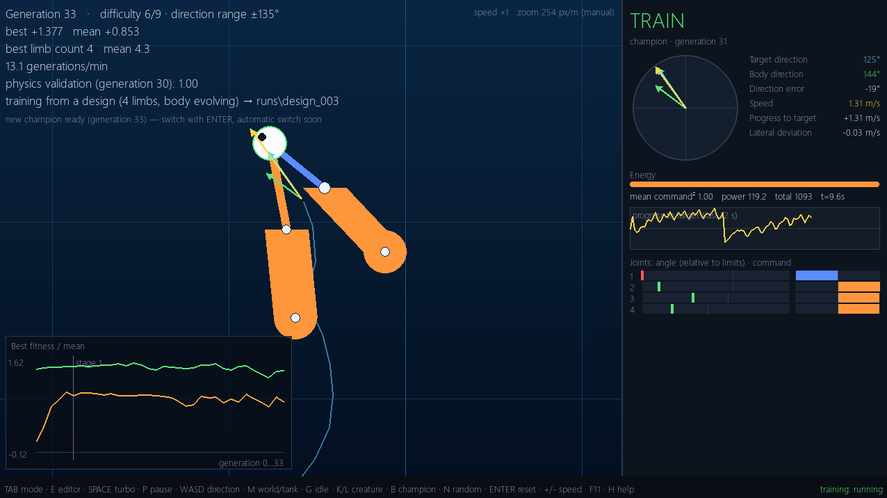

# Evolving Swimmers

Creatures made of a head, rod-like limbs and joints learn to swim in a simulated fluid.
**Their bodies and brains evolve together**: a neural network drives the joint torques,
while the genome also shapes limb count, lengths, angles and masses.
No movement is hard-coded. Swimming emerges only from joint torques and water drag.



## Highlights

- Custom 2D physics engine in NumPy (top-down view, no gravity, viscous anisotropic drag)
- Fixed-topology neural network outputs raw joint torques
- Body and brain are evolved together over hundreds of generations
- Steer a trained creature live with `WASD`
- Built-in creature design editor: draw a body, then train only its brain
- Optional ecosystem mode: food, reproduction, predation, carcasses (experimental)

## Quick start

```bash
pip install numpy pygame

# Open the app and start training from scratch
python app.py

# Try a pre-trained creature right away and steer it with WASD
python app.py --load examples/jellyfish.json
```

### Example creatures

| File | Description |
|------|-------------|
| `jellyfish.json` | 5 limbs, branching body, ~1.1 m/s in all 8 directions |
| `snake.json` | 6-limb chain, fast forward (~0.85 m/s), weak backwards/sideways |
| `example_symmetric_fish.json` | 6-limb symmetric chain, swims with a wave, ~0.51 m/s average over 8 directions |
| `example_design_fish.json` | Starting design for the editor (random brain) |

Files trained with older physics versions are tagged `[old physics]` and behave differently.

## Training

```bash
# Train from scratch
python train.py --out runs/test1 --workers 4

# Train from a design: body is frozen, only the brain evolves
python train.py --out runs/d2 --seed-from examples/example_design_fish.json --freeze-body
```

| Tool | Purpose |
|------|---------|
| `python validate.py file.json` | Checks that speed does not depend on the physics time step |
| `python eval_dirs.py file.json` | Performance in 8 directions + validation |
| `python test_physics.py`, `test_genome.py`, `test_evolution.py`, `test_app.py` | Test suites (creatures and UI) |
| `python test_world.py`, `test_eco.py` | Test suites (ecosystem) |

## How it works

### Physics (version 4)
- Linear (viscous) anisotropic drag, `dt = 0.005`
- Torque limits, joint limit springs, and total torque bounded by inertia.
  Version 3 showed numerical blow-ups on light, short bone chains (joint torques in the tens of thousands, results depending on `dt`), which version 4 fixes.
- Creatures start with the head pointing up (90°).

### Body direction = head direction
A fixed-length, motorless, invisible "nose" bone attached to the head defines the heading. All limbs attached to the head are articulated relative to it and powered; the reaction torque goes back to the head, so momentum is conserved. Symmetric creatures (like the jellyfish) driven symmetrically no longer drift sideways.
An older "legacy spine" mode (bone 1 passive, defines heading) is still supported for old files (`--legacy-spine`, or `O` in the editor).

### Brain and control
- Input: target direction (unit vector in the body frame) plus a sine/cosine clock
- Output: raw torques per motorized joint
- Evolution acts on body and brain weights together

### Curriculum
Difficulty adapts automatically through numbered notches: notch 0 = forward only, notches 1-8 = widening direction range (±22.5° up to ±180°), notch 9 = direction changes.
The difficulty rises by one notch when the champion performs well for several generations in a row; if it performs very badly for long enough, it steps back one notch.
"No command = stop" (notch 10) is currently disabled; enable with `--stop-command`.

### Stall prevention
- **Reward gate:** energy, spin and jitter penalties only count in full once the creature really moves, so "standing still" is never selected.
- **Stall detection:** if the 5-generation average of the champion's fitness does not improve for 15 generations, mutation size is boosted (x1.5 up to x3) and half of the migrants become heavily mutated copies of the elite. Disable with `--no-stall-boost`.

## Chapter 2: Ecosystem (experimental)

```bash
python eco.py                            # windowed view, 100 creatures, 40x40 m wrap-around world
python eco.py --headless --seconds 600   # headless run: summary lines + log.csv + survivors as JSON
python eco.py --seed-from a.json b.json  # start from your own creatures
python eco.py --random                   # random brains (they starve before learning to forage)
```

Tests: `python test_world.py`, `python test_eco.py`.

- **Part 1: Food.** Sources emit food at a constant rate and slowly drift. Eating gives energy. Movement costs real mechanical power, plus a base cost per mass. Zero energy means death. The nearest food direction feeds the brain's target-direction input.
- **Part 2: Reproduction.** Brain v2 has 85 inputs and 27 outputs (24 motors plus sexual reproduction, asexual reproduction and bite). Asexual: parent pays 160 energy, child starts with 80. Sexual: two willing creatures within 2 m pay 60 each, child is a crossover plus mutation. Maturation takes 5 s.
- **Part 3: Predation (not yet tuned).** Each creature has a diet gene in [0, 1] (0 herbivore, 1 carnivore) with a specialization cost. Bites capture prey energy, and kills leave carcasses that rot after 60 s. Energy is conserved (`World.balance_residual()` stays near 0, covered by tests).

Everything is configurable via `WorldConfig`.

## Status

Work in progress. Honest summary of the ecosystem so far:

- Seeded with three trained creatures, populations sustain at roughly 100-160 over 600 s, with 1500+ foods eaten and ~43 generations.
- Economy tuning let all three lineages (jellyfish, snake, fish) coexist.
- Sustainable carnivore niche: **not achieved yet**. Carnivores keep dying out in short, single-seed runs.
- Foraging does not yet evolve from random brains.

Feedback and ideas are very welcome.
